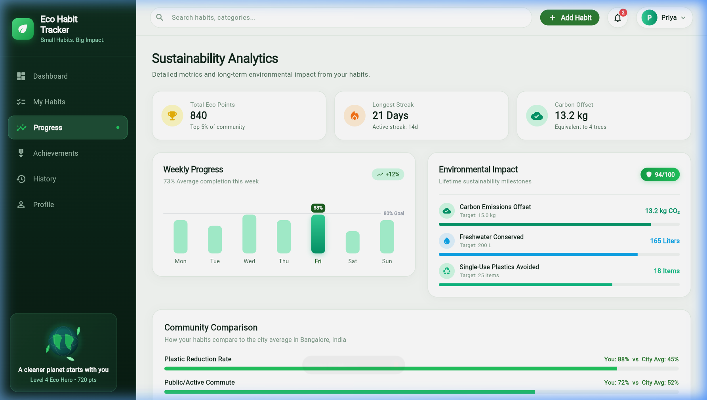
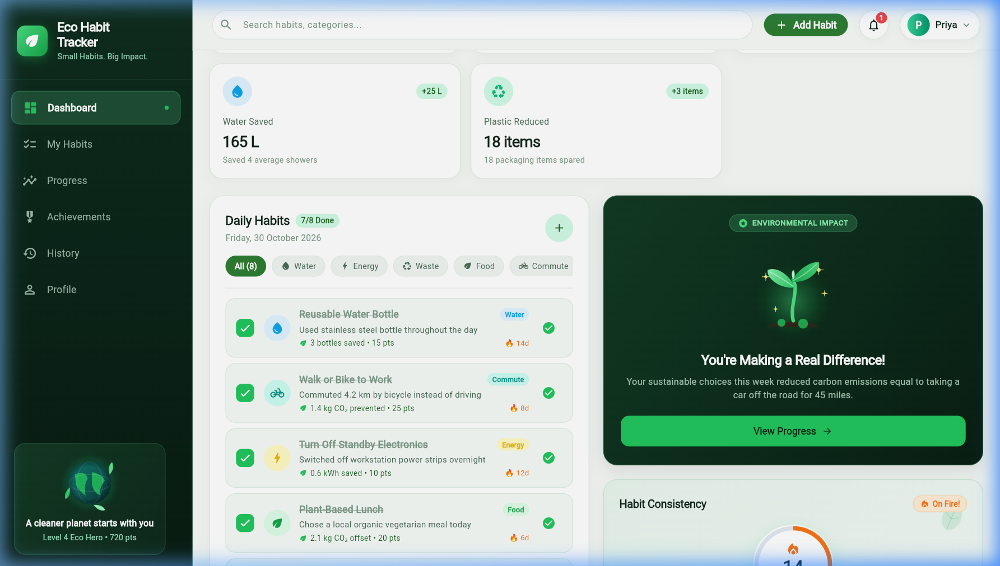
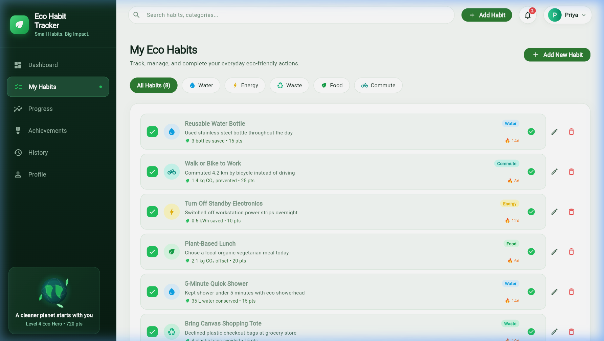
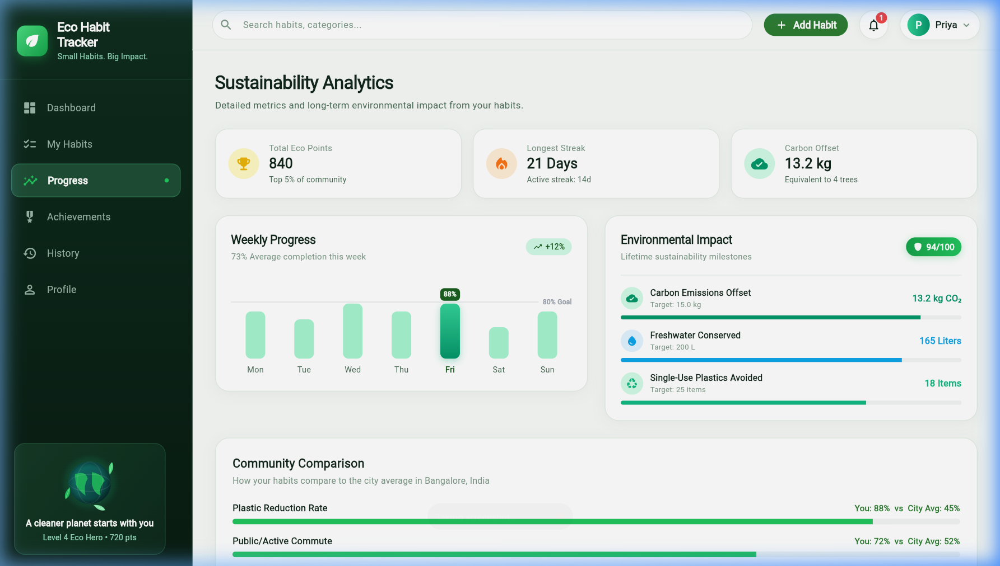
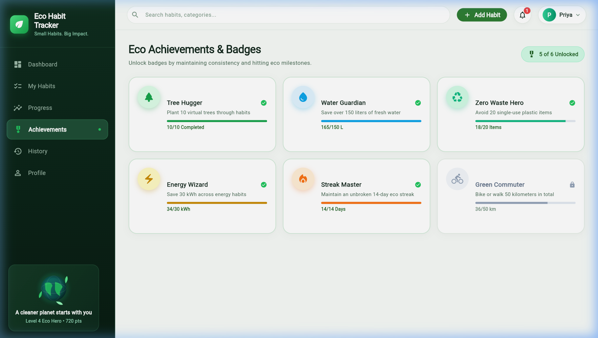
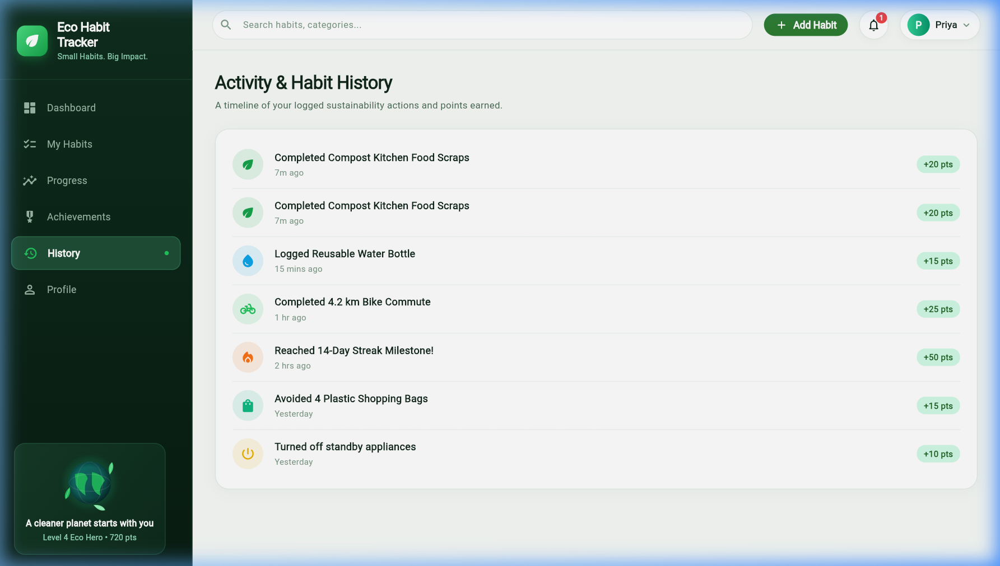
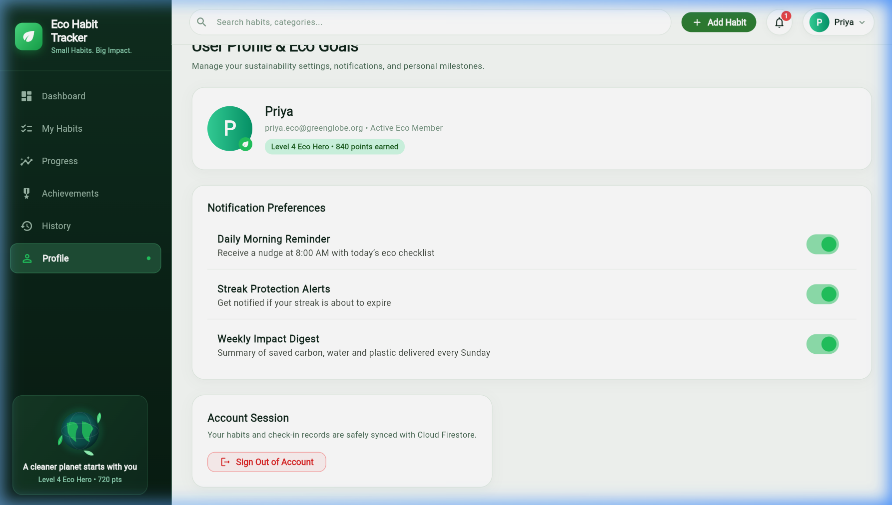
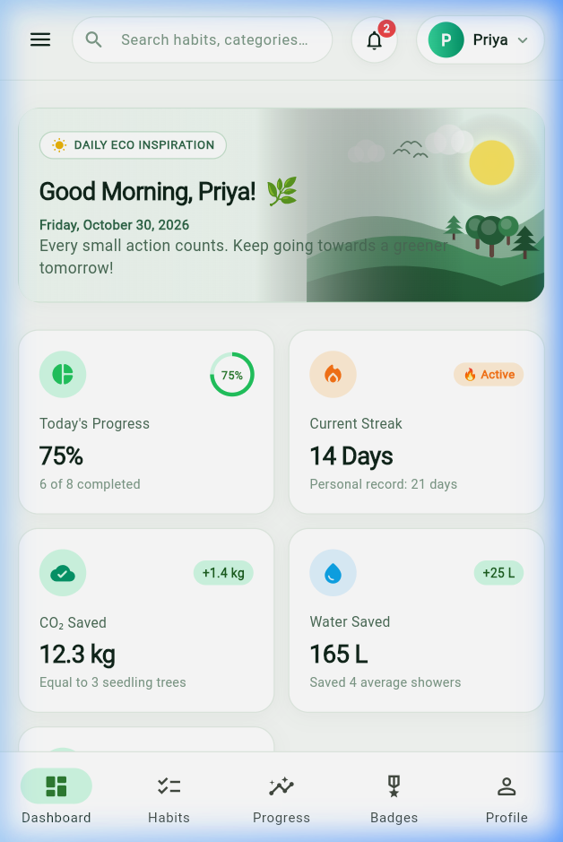
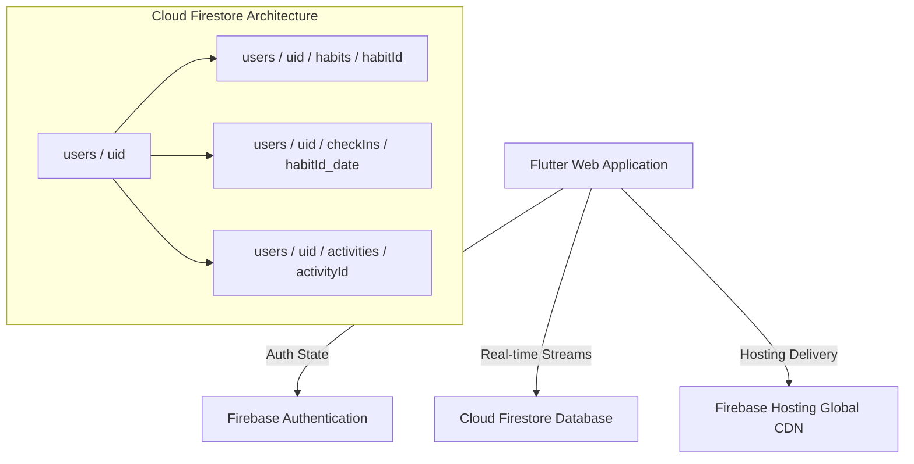

# 🌱 Eco Habit Tracker — Small Habits. Big Impact.

[](https://flutter.dev)
[](https://dart.dev)
[](https://firebase.google.com)
[](#)
[](https://eco-habit-tracker-b6677.web.app)

> **Eco Habit Tracker** is an interactive, gamified sustainability and habit-tracking web and mobile application built using Flutter Web and Google Firebase. It empowers individuals and communities to adopt micro-habits that directly combat climate change, reduce plastic footprint, conserve water, and minimize municipal waste.

---

## 🔗 Project Links

* **Live Web Application:** [https://eco-habit-tracker-b6677.web.app](https://eco-habit-tracker-b6677.web.app)
* **Alternative Domain:** [https://eco-habit-tracker-b6677.firebaseapp.com](https://eco-habit-tracker-b6677.firebaseapp.com)
* **GitHub Repository:** [https://github.com/swarnapriya17/ECO-HABIT-TRACKER.git](https://github.com/swarnapriya17/ECO-HABIT-TRACKER.git)
* **Firebase Project ID:** `eco-habit-tracker-b6677`

---

## 📌 Problem Statement

Anthropogenic carbon emissions, freshwater depletion, and non-biodegradable solid waste accumulation are among the most catastrophic crises confronting modern society. While governmental policies and enterprise initiatives are vital, individual lifestyle choices account for over **60% of global greenhouse gas emissions**. However, individuals often struggle with:

1. **Intangibility:** Inability to quantify how a single reusable bottle or a short shower translates into ecological preservation.
2. **Lack of Habit Reinforcement:** Sustainable behaviors are easily discarded without gamification, consistency tracking, and community feedback loops.
3. **Information Overload:** Eco-tips lack actionable, day-to-day structure and real-time impact metrics.

---

## 🎯 Objectives

1. **Democratize Environmental Impact Measurement:** Provide tangible, immediate calculations of CO₂ saved (kg), water conserved (Liters), and single-use plastic prevented (items).
2. **Drive Habitual Change via Gamification:** Implement progressive streaks, eco-score algorithms (0–100), milestone badges, and real-world impact goals (e.g., planting 1 virtual tree per 100 points).
3. **Deliver a Cross-Platform Cloud Experience:** Provide an instant, responsive interface for desktop, tablet, and mobile with user-isolated cloud synchronization powered by Cloud Firestore.

---

## 🌍 UN Sustainable Development Goals (SDG) Alignment

Eco Habit Tracker directly maps to and advances the following United Nations Sustainable Development Goals:

* **SDG 12: Responsible Consumption and Production (Target 12.5 & 12.8):**
  * Substantially reduce waste generation through prevention, reduction, recycling, and reuse (tracking tote bags, composting, and plastic bottle alternatives).
  * Ensure that people everywhere have relevant information and awareness for sustainable development and lifestyles in harmony with nature.
* **SDG 13: Climate Action (Target 13.3):**
  * Improve education, awareness-raising, and human and institutional capacity on climate change mitigation and impact reduction through quantified daily CO₂ savings.

---

## ✨ Core Features

| Feature | Description |
| :--- | :--- |
| **Authentication Flow** | Email and password sign-in, account creation with full name display, password reset dialog, and secure session management. |
| **Sustainability Dashboard** | Dynamic banner greeting, 5 live summary cards, 3-column desktop layout, streak tracker, and weekly progress charts. |
| **Habit Management** | Check-in toggling with optimistic UI updates, custom habit creation modal, inline editing, and deletion with safety confirmations. |
| **Smart Filtering & Search** | Real-time search across titles and descriptions, with category filter chips (Water, Energy, Plastic, Transport, Food). |
| **Analytics & Metrics** | Live weekly check-in graphs, cumulative impact counters, and dynamic Eco-Score calculation. |
| **Achievements & Badges** | 6 milestone badges with unlock criteria and progress indicators (*Tree Hugger*, *Water Guardian*, *Zero Waste Hero*, etc.). |
| **Activity Timeline** | Reverse-chronological feed logging habit creations, completions, milestones, and streak alerts. |
| **Responsive Design** | Fluid adaptation from desktop widescreen (1200px+) to tablet (768px–1199px) and mobile viewports (<768px). |
| **Custom Canvas Art** | 5 hand-crafted Flutter `CustomPainter` widgets (Earth Globe, Glowing Seedling, Scenic Landscape, Eco Banners, Leaves). |

---

## 📸 Application Screenshots

### 1. Authentication & Security


### 2. Main Sustainability Dashboard


### 3. My Eco Habits Management


### 4. Sustainability Progress & Analytics


### 5. Eco Achievements & Milestone Badges


### 6. Activity Timeline & History


### 7. User Profile & Eco Goals


### 8. Mobile Responsive Layout


---

## 🛠️ Technology Stack

* **Frontend Framework:** Flutter Web (Dart SDK `^3.12.2`, Flutter `3.44.8 Stable`)
* **Styling & Design System:** Custom Flutter Material 3 Theme (`AppTheme`), nature-inspired emerald palette (`#16A34A`, `#059669`, `#0D9488`, `#0284C7`, `#CA8A04`)
* **State Management:** Reactive ChangeNotifier Architecture (`HabitState`) with real-time stream subscriptions
* **Graphics & Visuals:** Flutter Custom Canvas (`CustomPainter`), CanvasKit renderer
* **Backend as a Service:** Google Firebase
  * **Firebase Authentication:** Secure email/password authentication and credential persistence
  * **Cloud Firestore:** NoSQL real-time document database with subcollection architecture
  * **Firebase Hosting:** Global SSD CDN hosting with SSL certificate and SPA URL rewrites
* **Testing:** `flutter_test` suite with Unit and Widget UI tests

---

## 🏗️ System Architecture & Data Model



### Firestore Schema Details

* `/users/{uid}`: Holds user profile document (`displayName`, `email`, `totalPoints`, `streakDays`, `ecoScore`, `level`, `createdAt`).
* `/users/{uid}/habits/{habitId}`: Stores user-created habits with metadata (`title`, `category`, `impactText`, `points`, `co2ImpactKg`, `waterImpactL`, `plasticImpactItems`).
* `/users/{uid}/checkIns/{habitId_date}`: Deterministic daily completion document ensuring idempotency (`habitId`, `date`, `completedAt`, `points`).
* `/users/{uid}/activities/{activityId}`: Event stream capturing habit completions, milestones, and streak notifications.

### Firestore Security Rules

Access control is enforced at the database level using `firestore.rules`:

```javascript
rules_version = '2';
service cloud.firestore {
  match /databases/{database}/documents {
    function isAuthenticated() { return request.auth != null; }
    function isOwner(userId) { return isAuthenticated() && request.auth.uid == userId; }

    match /{document=**} { allow read, write: if false; }

    match /users/{userId} {
      allow read, write: if isOwner(userId);
      match /habits/{habitId} { allow read, write: if isOwner(userId); }
      match /checkIns/{checkInId} { allow read, write: if isOwner(userId); }
      match /activities/{activityId} { allow read, write: if isOwner(userId); }
    }
  }
}
```

---

## 🚀 Local Development & Execution

### Prerequisites
* Flutter SDK (Version `>=3.22.0`)
* Dart SDK (`>=3.12.0`)
* Google Chrome or Edge browser
* Git

### Step-by-Step Setup

1. **Clone the repository:**
   ```bash
   git clone https://github.com/swarnapriya17/ECO-HABIT-TRACKER.git
   cd ECO-HABIT-TRACKER
   ```

2. **Install project dependencies:**
   ```bash
   flutter pub get
   ```

3. **Verify code quality:**
   ```bash
   dart format .
   flutter analyze
   ```

4. **Execute automated test suites:**
   ```bash
   flutter test
   ```

5. **Run locally on Web Server:**
   ```bash
   flutter run -d chrome
   # or run on a specific web port:
   flutter run -d web-server --web-port=8085 --web-hostname=localhost
   ```

---

## 📦 Production Build & Deployment

### Build Release Artifacts
```bash
flutter build web --release
```
The optimized bundle is generated in `build/web/`.

### Deploy to Firebase Hosting
```bash
firebase deploy --only hosting --project eco-habit-tracker-b6677
```

---

## 🧪 Testing Summary

| Test Category | Suite / Command | Result | Details |
| :--- | :--- | :---: | :--- |
| **Static Analysis** | `flutter analyze` | **PASS** | 0 warnings, 0 errors, strict lint conformity. |
| **Model Serialization** | `test/models_test.dart` | **PASS** | 4 unit tests covering Habit, CheckIn, UserProfile, and Activity serialization. |
| **Authentication Form UI** | `test/auth_screen_test.dart` | **PASS** | Form validation, password toggle, and dialog switching verified. |
| **Desktop Responsiveness** | `test/widget_test.dart` | **PASS** | 1536x960 viewport navigation and habit toggle verified. |
| **Mobile Responsiveness** | `test/widget_test.dart` | **PASS** | 390x844 viewport rendered cleanly with drawer and bottom navigation. |
| **Live Web App Validation** | Browser Subagent & Playwright | **PASS** | Live deployment rendered with CanvasKit and zero console exceptions. |

---

## 🔮 Limitations & Future Enhancements

### Current Limitations
1. **Third-Party Integrations:** Carbon and water savings rely on standard ecological benchmark formulas rather than smart utility meter API feeds.
2. **Social Community Feed:** Currently focused on personal accountability; public leaderboards require explicit social sharing opt-in.

### Future Scope
1. **IoT Smart Meter Integration:** Connect with smart water meters and home electricity plugs for automated check-in verification.
2. **AI Eco-Assistant:** Deploy an on-device or cloud LLM agent to analyze grocery receipts and recommend tailored sustainable alternatives.
3. **Native Mobile App Store Release:** Publish pre-configured builds to Google Play Store and Apple App Store using Flutter's multi-platform capabilities.

---

## 👥 Authors & Academic Attribution

* **Developer:** Swarna Priya ([@swarnapriya17](https://github.com/swarnapriya17))
* **Project:** Eco Habit Tracker — Academic Capstone & Sustainability Portfolio
* **Institution:** [College / University Name Placeholder]
* **Department:** Department of Computer Science and Engineering
