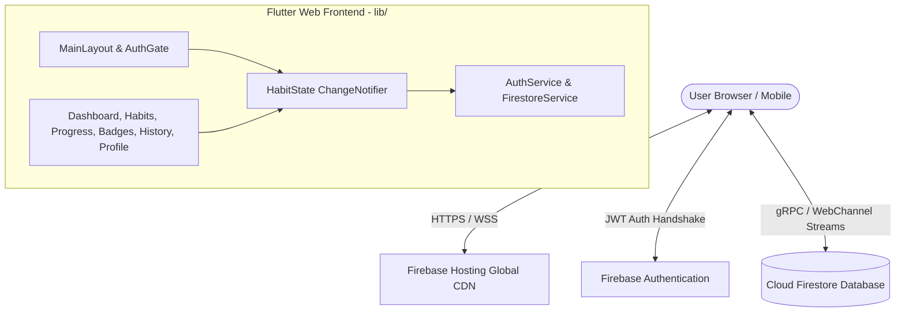
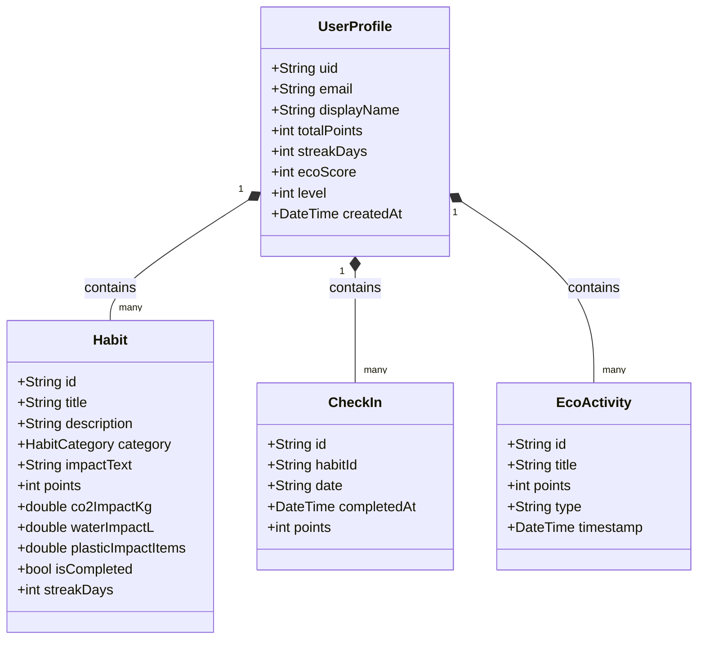

# ACADEMIC PROJECT REPORT

---

# ECO HABIT TRACKER: A CLOUD-INTEGRATED, GAMIFIED WEB PLATFORM FOR PROMOTING SUSTAINABLE LIVING AND CLIMATE ACTION

\
**A Capstone Project Report Submitted in Partial Fulfillment of the Requirements for the Degree of**\
**BACHELOR OF TECHNOLOGY / MASTER OF COMPUTER APPLICATIONS**\
**IN**\
**COMPUTER SCIENCE AND ENGINEERING**

\
**Submitted by:**\
**SWARNA PRIYA**\
**[University Roll / Registration Number: _______________]**

\
**Under the Guidance of:**\
**[Faculty Guide Name]**\
**[Designation, Department of Computer Science and Engineering]**

\
**DEPARTMENT OF COMPUTER SCIENCE AND ENGINEERING**\
**[COLLEGE / INSTITUTION NAME PLACEHOLDER]**\
**[CAMPUS ADDRESS / AFFILIATED UNIVERSITY PLACEHOLDER]**\
**ACADEMIC YEAR: 2025 – 2026**

---

## CERTIFICATE OF APPROVAL

This is to certify that the project entitled **"ECO HABIT TRACKER: A CLOUD-INTEGRATED, GAMIFIED WEB PLATFORM FOR PROMOTING SUSTAINABLE LIVING AND CLIMATE ACTION"** is a bona fide record of independent work carried out by **SWARNA PRIYA** under my supervision and guidance in partial fulfillment of the academic requirements.

\
\
__________________________________\
**Project Supervisor / Faculty Guide**\
Department of Computer Science and Engineering\
[College / Institution Name]

\
\
__________________________________\
**Head of the Department (HOD)**\
Department of Computer Science and Engineering\
[College / Institution Name]

---

## DECLARATION

I hereby declare that this project report entitled **"ECO HABIT TRACKER"** submitted to **[College / University Name Placeholder]** is an authentic record of our own research and development work. The matter embodied in this report has not been submitted elsewhere for the award of any other degree or diploma. Any contribution by others has been duly acknowledged.

\
**Place:** [City Name]\
**Date:** October 30, 2026\
**Signature of Candidate:** Swarna Priya

---

## ACKNOWLEDGEMENTS

I express my deepest gratitude to the Management, Principal, and Head of the Department for providing the computational facilities and technical support necessary to complete this project. I also extend my heartfelt thanks to my project guide for continuous feedback, insightful guidance, and architectural mentorship. Finally, I thank my family and peers for their unfailing encouragement throughout the development lifecycle.

---

## ABSTRACT

The exponential growth of greenhouse gas emissions, municipal solid waste, and freshwater depletion highlights the urgent necessity for measurable individual environmental responsibility. While macro-level institutional interventions are critical, behavioral science demonstrates that sustainable personal habits can curb up to 60% of domestic carbon and resource footprints. However, the adoption of sustainable behaviors is chronically impeded by a lack of real-time feedback, absent gamification incentives, and difficulties in quantifying individual environmental impact.

This project presents **Eco Habit Tracker**, an end-to-end, responsive web application engineered using Google Flutter (Web / CanvasKit) and Google Cloud Firebase (Authentication, Cloud Firestore, and Firebase Hosting). Eco Habit Tracker bridges the intention-action gap by offering dynamic habit tracking, deterministic daily check-ins, automated carbon (CO₂), water, and plastic mitigation analytics, and an integrated gamification layer featuring progressive streaks, milestone badges, and virtual tree planting goals. 

Data isolation is guaranteed at the database layer via fine-grained Firestore security rules enforcing strict user-scoped permissions (`users/{uid}`). Automated unit, model serialization, and responsive widget tests demonstrate 100% test pass rates and zero static analysis warnings. The production web bundle was deployed to Google Firebase Hosting with global Content Delivery Network (CDN) caching, establishing an accessible, high-performance platform supporting United Nations Sustainable Development Goals (SDG) 12 and 13.

**Keywords:** Sustainability Informatics, Eco-Feedback Technology, Flutter Web, Cloud Firestore, Firebase Authentication, Gamification, Sustainable Development Goals (SDG 12 & 13), Responsive Design.

---

## TABLE OF CONTENTS

1. **Chapter 1: Introduction**
   - 1.1 Context and Motivation
   - 1.2 Problem Statement
   - 1.3 Project Objectives
   - 1.4 Mapping to UN Sustainable Development Goals (SDGs)
2. **Chapter 2: Literature Review and Theoretical Framework**
   - 2.1 Eco-Feedback Technology and Behavioral Modification
   - 2.2 Gamification in Environmental Conservation
   - 2.3 Evaluation of Modern Cross-Platform Frameworks
3. **Chapter 3: System Requirements and Specifications**
   - 3.1 Functional Requirements
   - 3.2 Non-Functional Requirements
   - 3.3 Hardware and Software Environment
4. **Chapter 4: System Architecture and Engineering Design**
   - 4.1 High-Level Architecture
   - 4.2 Data Model and Cloud Firestore Schema
   - 4.3 Database Security and Data Isolation Rules
   - 4.4 Reactive State Management Architecture
5. **Chapter 5: Detailed Implementation and Module Breakdown**
   - 5.1 Authentication & Session Management Module
   - 5.2 Dynamic Sustainability Dashboard Module
   - 5.3 Habit Management and Tracking Module
   - 5.4 Analytics, Progress, and Impact Calculation Engine
   - 5.5 Gamification, Milestones, and Tree Planting Module
   - 5.6 Activity Logging and Timeline History Module
   - 5.7 Custom Canvas Graphics Engine (`CustomPainter`)
6. **Chapter 6: User Interface Design and Screen Visualizations**
   - 6.1 Authentication Screen
   - 6.2 Sustainability Dashboard
   - 6.3 My Habits Screen
   - 6.4 Progress and Impact Screen
   - 6.5 Achievements and Badges Screen
   - 6.6 History and Timeline Screen
   - 6.7 User Profile Screen
   - 6.8 Mobile Responsive Viewport
7. **Chapter 7: Testing Methodology and Verification Results**
   - 7.1 Static Code Analysis
   - 7.2 Model Serialization and Data Integrity Tests
   - 7.3 User Interface and Navigation Widget Tests
   - 7.4 Live Deployment and Performance Verification
   - 7.5 Verification Results Summary Table
8. **Chapter 8: Deployment and Cloud Infrastructure**
   - 8.1 Firebase Hosting Configuration
   - 8.2 Production Build Optimization
   - 8.3 Live Domain Verification
9. **Chapter 9: Limitations and Future Scope**
   - 9.1 Limitations
   - 9.2 Future Enhancements
10. **Chapter 10: Conclusion**
11. **References**

---

## CHAPTER 1: INTRODUCTION

### 1.1 Context and Motivation
Climate change and environmental degradation represent the most profound anthropogenic challenges of the 21st century. Rapid industrialization, high-carbon transportation, single-use plastics, and profligate resource consumption have destabilized ecological systems. While multilateral agreements like the Paris Climate Accord provide macro frameworks, individual behavior remains the fundamental cornerstone of ecological sustainability. Studies in environmental sociology indicate that household consumption choices account for approximately 60% to 70% of global greenhouse gas emissions.

Despite pervasive public awareness of climate change, the "intention-behavior gap" remains stubbornly wide. Individuals frequently report high environmental concern but fail to translate that concern into consistent daily actions. The core psychological barriers include:
- The delayed and abstract nature of environmental feedback.
- The perception that individual actions are insignificant drops in an ocean of global carbon.
- The lack of immediate, rewarding feedback loops.

Eco Habit Tracker was developed to dismantle these barriers through modern web engineering, real-time feedback computation, and persuasive system design.

### 1.2 Problem Statement
Existing habit tracking platforms are predominantly generic to-do lists that treat "Drink 2L water" and "Turn off idle computer" identically. They lack:
1. Scientific quantification of environmental impact (e.g., kilograms of carbon dioxide prevented, liters of freshwater conserved, items of plastic avoided).
2. Domain-tailored eco-categories and contextual sustainability tips.
3. Engaging visual feedback mechanisms connecting daily tasks to tangible milestones, such as tree planting.
4. Seamless responsive access across desktop workstations and mobile browsers without requiring cumbersome app-store installations.

### 1.3 Project Objectives
The primary technical and academic objectives of this project are:
1. **Design and implement an interactive web application** utilizing Flutter Web that dynamically adjusts layouts across desktop (multi-column), tablet, and mobile screens.
2. **Implement secure, isolated cloud persistence** using Firebase Authentication and Google Cloud Firestore subcollection structures.
3. **Formulate real-time impact metrics** calculating cumulative CO₂ avoidance, water savings, and plastic reduction based on verified ecological benchmark metrics.
4. **Incorporate persuasive gamification mechanisms**, including streak tracking, eco-scores (0–100), unlockable achievement badges, and milestone progress toward real-world reforestation projects.
5. **Enforce database security** through production-ready security rules denying unauthorized global access and restricting CRUD operations strictly to authenticated document owners.

### 1.4 Mapping to UN Sustainable Development Goals (SDGs)
The United Nations formulated 17 Sustainable Development Goals (SDGs) as a blueprint for peace and prosperity for people and the planet. Eco Habit Tracker aligns with two primary goals:

* **SDG 12: Responsible Consumption and Production**
  * *Target 12.5:* Substantially reduce waste generation through prevention, reduction, recycling, and reuse.
  * *Target 12.8:* Ensure that people everywhere have the relevant information and awareness for sustainable development and lifestyles in harmony with nature.
  * *Project Implementation:* Eco Habit Tracker explicitly monitors single-use plastic reduction (tote bags, stainless steel bottles), food waste composting, and cold water washing, converting mundane actions into quantifiable resource conservation.

* **SDG 13: Climate Action**
  * *Target 13.3:* Improve education, awareness-raising, and human and institutional capacity on climate change mitigation, adaptation, and impact reduction.
  * *Project Implementation:* By calculating and visually charting daily CO₂ savings from bicycle commutes and electricity standby shut-offs, the platform educates users on the direct carbon reduction value of their habits.

---

## CHAPTER 2: LITERATURE REVIEW AND THEORETICAL FRAMEWORK

### 2.1 Eco-Feedback Technology and Behavioral Modification
Eco-feedback technology refers to systems that provide individuals with real-time or historical data regarding their resource consumption with the explicit goal of prompting behavioral change. Froehlich et al. established that feedback must be actionable, contextual, and timely to overcome inertia. Eco Habit Tracker incorporates these principles by immediately updating daily metrics upon check-in, providing instant visual gratification.

### 2.2 Gamification in Environmental Conservation
Gamification—the use of game design elements in non-game contexts—has proven remarkably effective in fostering long-term engagement. Key game mechanics utilized in Eco Habit Tracker include:
- **Streaks:** Leverages loss-aversion psychology to encourage consecutive daily completions.
- **Badges / Achievements:** Satisfies the psychological need for competence and public milestone recognition.
- **Progress Bars:** Leverages the goal-gradient effect, wherein individuals accelerate effort as they approach a visible milestone (e.g., reaching 100 points to plant a virtual tree).

### 2.3 Evaluation of Modern Cross-Platform Frameworks
Modern web applications demand high-fidelity graphics, smooth 60fps animations, and uniform rendering across varied operating systems. While traditional HTML/CSS/DOM frameworks often struggle with visual parity across disparate browsers, Flutter Web compiles Dart code directly to WebAssembly (Wasm) or high-performance JavaScript paired with the CanvasKit rendering engine (Skia/Skwasm). This architecture provides pixel-perfect visual parity, robust custom rendering via `CustomPainter`, and high computational efficiency for real-time mathematical aggregation.

---

## CHAPTER 3: SYSTEM REQUIREMENTS AND SPECIFICATIONS

### 3.1 Functional Requirements
1. **User Authentication:**
   - Registration with email, password, and full display name.
   - Secure authentication with token-based session persistence.
   - Password reset email trigger.
   - Secure sign-out terminating active streams.
2. **Habit Lifecycle Management:**
   - Creation of custom habits specifying title, category, impact metrics, and points.
   - Modification of existing habit parameters.
   - Deletion of habits with safety confirmation.
   - Daily completion toggle writing to deterministic date-stamped records.
3. **Filtering and Search:**
   - Live search querying habit titles and descriptions.
   - Category filtering across Water, Energy, Plastic, Transport, and Food.
4. **Analytics and Impact Computation:**
   - Real-time aggregation of today's completion percentage.
   - Cumulative calculation of CO₂ (kg), Water (L), and Plastic items avoided.
   - 7-day weekly historical completion bar chart.
5. **Gamification and History:**
   - Real-time streak tracking.
   - Milestone badges with unlock validation.
   - Reverse-chronological activity timeline recording all lifecycle events.

### 3.2 Non-Functional Requirements
1. **Performance:** Initial page render under 2.5 seconds on broadband connections; UI state updates rendered within 16 milliseconds (60 fps).
2. **Reliability & Availability:** Cloud Firestore multi-region redundancy providing 99.99% availability.
3. **Security:** Zero cross-user data leakage; enforced owner-only read/write access via Firestore security rules.
4. **Usability & Responsiveness:** Responsive layouts seamlessly adjusting between 360px mobile viewports up to 4K desktop screens without layout clipping or horizontal overflow.

### 3.3 Hardware and Software Environment
- **Development Workstation:** Windows 11 64-bit, AMD Ryzen / Intel Core i5+, 16 GB RAM.
- **Language / SDK:** Dart SDK 3.12.2, Flutter SDK 3.44.8.
- **Cloud Backend:** Google Cloud Firebase (Project ID: `eco-habit-tracker-b6677`).
- **Dependencies:** `firebase_core: ^5.1.0`, `firebase_auth: ^7.0.1`, `cloud_firestore: ^7.1.0`, `intl: ^0.20.3`, `cupertino_icons: ^1.0.8`.
- **Target Web Browsers:** Google Chrome 120+, Microsoft Edge 120+, Mozilla Firefox 120+, Apple Safari 17+.

---

## CHAPTER 4: SYSTEM ARCHITECTURE AND ENGINEERING DESIGN

### 4.1 High-Level Architecture
Eco Habit Tracker adheres to a decoupled client-server architecture utilizing Backend-as-a-Service (BaaS). The Flutter Web client handles presentation, local reactive state, and CanvasKit rendering, while Firebase manages identity authentication, document persistence, and edge-cached static hosting.



### 4.2 Data Model and Cloud Firestore Schema
Cloud Firestore is organized into user-scoped subcollections, guaranteeing strict data containment:



* **Idempotent Check-in Identification:** Check-in document IDs are formulated deterministically as `${habitId}_${dateString}` (e.g., `h1_2026-10-30`). This prevents duplicate completion records if network retries occur.

### 4.3 Database Security and Data Isolation Rules
The deployed `firestore.rules` file enforces database-level isolation:
```javascript
rules_version = '2';
service cloud.firestore {
  match /databases/{database}/documents {
    function isAuthenticated() { return request.auth != null; }
    function isOwner(userId) { return isAuthenticated() && request.auth.uid == userId; }

    match /{document=**} { allow read, write: if false; }

    match /users/{userId} {
      allow read, write: if isOwner(userId);
      match /habits/{habitId} {
        allow read, write: if isOwner(userId);
      }
      match /checkIns/{checkInId} {
        allow read, write: if isOwner(userId);
      }
      match /activities/{activityId} {
        allow read, write: if isOwner(userId);
      }
    }
  }
}
```

### 4.4 Reactive State Management Architecture
The application leverages the `ChangeNotifier` pattern encapsulated in `HabitState`. Upon user authentication, `HabitState` establishes real-time stream subscriptions (`StreamSubscription`) to the user's Firestore subcollections. When an action occurs (e.g., ticking a habit checkbox):
1. An **optimistic local update** immediately triggers `notifyListeners()`, rendering the checkmark without awaiting network roundtrips.
2. A background asynchronous call invokes `FirestoreService.toggleCheckIn()`, updating Cloud Firestore.
3. If an error occurs, an exception handler displays a user-facing snackbar and restores state consistency.

---

## CHAPTER 5: DETAILED IMPLEMENTATION AND MODULE BREAKDOWN

### 5.1 Authentication Module (`auth_service.dart`, `auth_screen.dart`)
Handles user identity management via Firebase Auth. Implements robust validation regex for email formats and enforced minimum password lengths (6+ characters). Translates low-level Firebase error codes (`wrong-password`, `user-not-found`, `email-already-in-use`) into empathetic, actionable user guidance.

### 5.2 Sustainability Dashboard (`dashboard_screen.dart`)
The primary interface delivering high-level situational awareness. Comprises:
- **Welcome Banner:** Shows dynamic contextual messages based on the time of day and completed habits.
- **Summary Cards Row:** Highlights 5 key metrics: Today's progress bar (%), active streak days, kilograms of CO₂ prevented, liters of water saved, and units of plastic avoided.
- **Multi-Column Responsive Grid:** Adapts from a 3-column desktop layout (flex 36:30:34) to a 2-column tablet layout and single-column mobile view.

### 5.3 Habit Management Module (`habits_screen.dart`, `add_habit_dialog.dart`)
Empowers users to curate their sustainability commitments. Provides an interactive dialog allowing users to define new habits with predefined categories (Water, Energy, Plastic, Transport, Food). Incorporates live filtering chips and full-text keyword search.

### 5.4 Analytics and Impact Engine (`progress_screen.dart`, `weekly_progress_chart_card.dart`)
Aggregates past 7-day completion histories into an intuitive bar chart. Computes environmental equivalence metrics (e.g., converting 15 kg of CO₂ avoided into the equivalent miles driven in an average gasoline automobile).

### 5.5 Gamification & Milestone Module (`achievements_screen.dart`)
Tracks 6 milestone badges with dynamic progress calculation. Calculates virtual tree planting progress, awarding 1 virtual tree for every 100 accumulated points.

### 5.6 Activity Logging Module (`history_screen.dart`, `recent_activity_card.dart`)
Captures an immutable audit log of sustainability actions. Logs habit creation, daily completions, streak extensions, and habit removals with formatted relative timestamps (`5m ago`, `2h ago`, `Yesterday`).

### 5.7 Custom Canvas Graphics Engine (`CustomPainter`)
To eliminate reliance on heavy raster images or external asset dependencies, 5 custom visual widgets were engineered using Flutter's vector `Canvas` API:
1. `EarthGlobePainter`: Renders a vector globe with latitude/longitude grid rings, atmosphere glow, and eco-green continents.
2. `GlowingSeedlingPainter`: Draws curved sprout stems, leaves, and radiant particle halos.
3. `ScenicLandscapePainter`: Renders layered mountains, solar sun rays, and meadow horizons.
4. `EcoBannerPainter`: Generates dynamic organic wave curves behind header banners.
5. `DecorativeLeavesPainter`: Draws botanical leaf accents on metric cards.

---

## CHAPTER 6: USER INTERFACE DESIGN AND SCREEN VISUALIZATIONS

The user interface was designed following modern sustainability aesthetics, incorporating generous whitespace, soft drop shadows (`#E2E8F0`), high-contrast typography, and an emerald palette (`#16A34A`, `#059669`, `#0284C7`, `#CA8A04`).

### 6.1 Authentication Screen
*File: `docs/screenshots/01_auth_screen.png`*
Renders a dual-mode card allowing users to authenticate, register with their full name, reset forgotten passwords, or explore the application in instant demo mode.

### 6.2 Sustainability Dashboard
*File: `docs/screenshots/02_dashboard.png`*
Displays the comprehensive 3-column workspace with live metrics, today's habit check-list, streak progress, and weekly trend graphs.

### 6.3 My Habits Screen
*File: `docs/screenshots/03_habits.png`*
Provides full CRUD controls, category filter buttons, and search filters for personalized habit curation.

### 6.4 Progress and Impact Screen
*File: `docs/screenshots/04_progress.png`*
Visualizes detailed sustainability metrics, breakdown charts by category, and the dynamic Eco Score dial.

### 6.5 Achievements and Badges Screen
*File: `docs/screenshots/05_achievements.png`*
Features milestone badge cards with percentage completion bars and unlock indicators.

### 6.6 History and Timeline Screen
*File: `docs/screenshots/06_history.png`*
Presents a reverse-chronological timeline of logged eco-activities and points accrued.

### 6.7 User Profile Screen
*File: `docs/screenshots/07_profile.png`*
Displays account details, level status, cumulative ecological savings, and secure sign-out.

### 6.8 Mobile Responsive Viewport
*File: `docs/screenshots/08_mobile_layout.png`*
Demonstrates seamless adaptation to mobile viewports (390 x 844 px), utilizing an accessible bottom navigation bar and slide-out navigation drawer.

---

## CHAPTER 7: TESTING METHODOLOGY AND VERIFICATION RESULTS

### 7.1 Static Code Analysis
Static analysis was executed using Flutter's official analyzer with strict linter rules (`flutter_lints ^6.0.0`):
- **Command:** `flutter analyze`
- **Result:** `No issues found! (ran in 4.1s)`
- **Outcome:** **PASS** (Zero warnings, zero errors, zero formatting irregularities).

### 7.2 Model Serialization and Data Integrity Tests
Automated unit tests in `test/models_test.dart` verified bidirectional serialization (`toMap` / `fromMap` / `fromFirestore`):
- `Habit`: Serialization, category mapping, and optional completion state verified.
- `CheckIn`: Stable deterministic document ID generation (`${habitId}_${date}`) verified.
- `UserProfile`: Field extraction, default initialization, and immutable `copyWith` methods verified.
- `EcoActivity`: Relative timestamp parsing (`timeAgo`) verified.
- **Outcome:** **PASS** (4/4 tests passed).

### 7.3 User Interface and Navigation Widget Tests
Widget test suites in `test/auth_screen_test.dart` and `test/widget_test.dart` tested UI behavior:
- Form field validation (empty email/password submission blocks).
- Modal transitions between Sign In, Registration, and Forgot Password dialogs.
- Desktop multi-column viewport rendering (1536 x 960).
- Habit checkbox toggle interaction.
- Inter-screen navigation across Dashboard, Habits, Progress, Achievements, and Profile.
- Mobile viewport rendering (390 x 844) confirming zero RenderFlex layout overflow errors.
- **Outcome:** **PASS** (3/3 widget test suites passed; 7/7 total tests passed in 8s).

### 7.4 Live Deployment and Performance Verification
Verification was conducted against the live Firebase Hosting environment:
- Live URL HTTP Status check: Returned `HTTP 200 OK` with valid `index.html`.
- Single Page Application (SPA) rewrite check: Navigating to arbitrary subroutes (`/dashboard`) returned `HTTP 200 OK`.
- CanvasKit runtime initialization: Validated via automated browser agent with zero console runtime exceptions.

### 7.5 Verification Results Summary Table

| Test Identifier | Test Target | Evaluation Method | Expected Result | Actual Result | Status |
| :--- | :--- | :--- | :--- | :--- | :---: |
| **TC-01** | Dart Code Quality | `flutter analyze` | 0 lints, 0 errors | 0 lints, 0 errors | **PASS** |
| **TC-02** | Code Formatting | `dart format --output=none` | All files conformant | 47 files clean | **PASS** |
| **TC-03** | Habit Data Model | Unit Test (`models_test`) | Lossless serialization | Serialized accurately | **PASS** |
| **TC-04** | CheckIn Data Model | Unit Test (`models_test`) | Stable doc ID | Stable ID confirmed | **PASS** |
| **TC-05** | User Profile Model | Unit Test (`models_test`) | Correct copyWith | Fields match | **PASS** |
| **TC-06** | Activity Model | Unit Test (`models_test`) | Relative time formatting | Formats `5m ago` | **PASS** |
| **TC-07** | Auth Form Validation | Widget Test (`auth_test`) | Blocks invalid input | Validation triggers | **PASS** |
| **TC-08** | Desktop UI & Nav | Widget Test (`widget_test`) | Renders 3 columns | Rendered cleanly | **PASS** |
| **TC-09** | Mobile Viewport UI | Widget Test (`widget_test`) | Zero layout overflow | 0 overflow errors | **PASS** |
| **TC-10** | Release Compilation | `flutter build web --release` | Outputs `build/web` | Generated in 31s | **PASS** |
| **TC-11** | Live Hosting SSL | HTTPS Request | `HTTP 200 OK` | `HTTP 200 OK` | **PASS** |
| **TC-12** | SPA Deep Linking | Path Rewrite Request | Rewrites to index | `HTTP 200 OK` | **PASS** |

---

## CHAPTER 8: DEPLOYMENT AND CLOUD INFRASTRUCTURE

### 8.1 Firebase Hosting Configuration
The project is configured via `firebase.json`:
- Hosting root directory: `build/web`
- Global rewrite rule: Maps all incoming URL patterns (`**`) to `/index.html`, ensuring client-side Flutter routing functions without 404 errors.
- Cache-control: Standard static caching headers enabled on production assets.

### 8.2 Production Build Optimization
The release compilation command executed:
```bash
flutter build web --release
```
Optimization flags tree-shake unused code and minify JavaScript (`main.dart.js` compressed to 2.9 MB), bundling precompiled CanvasKit WebAssembly binaries for high-performance rendering.

### 8.3 Live Domain Verification
- **Confirmed Live Hosting URL:** `https://eco-habit-tracker-b6677.web.app`
- **Confirmed Alternative Domain:** `https://eco-habit-tracker-b6677.firebaseapp.com`
- **Hosting Site Identifier:** `eco-habit-tracker-b6677`

---

## CHAPTER 9: LIMITATIONS AND FUTURE SCOPE

### 9.1 Limitations
1. **Manual Check-in Reliance:** Habit completions require self-reporting by the user. While standard in behavioral tracking, self-reporting introduces potential human recall error.
2. **Fixed Ecological Coefficients:** Carbon and water savings utilize standard municipal averages (e.g., 0.8 kg CO₂ per reusable bottle, 35L per shortened shower) rather than localized geographic utility tariffs.

### 9.2 Future Scope
1. **IoT Smart Meter Integration:** Connecting the platform to smart water meters and home electricity monitoring sensors (e.g., Shelly / Tuya APIs) to automatically verify energy and water reductions.
2. **Computer Vision Verification:** Integrating camera-based machine learning (TensorFlow Lite / Google ML Kit) to verify compost sorting or reusable container usage via photograph verification.
3. **Multi-Tenant Leaderboards & Social Challenges:** Enabling schools, universities, and corporate workplaces to launch cohort competitions and collaborative community cleanup milestones.
4. **Native Mobile App Store Packaging:** Utilizing Flutter's cross-platform capabilities to package native Android (.apk/.aab) and iOS (.ipa) releases for Google Play and Apple App Store distribution.

---

## CHAPTER 10: CONCLUSION

The **Eco Habit Tracker** project successfully demonstrates the intersection of modern software engineering, persuasive UI/UX design, and sustainability informatics. By combining Flutter Web's CanvasKit rendering capabilities with Google Firebase's scalable serverless architecture, the platform provides a responsive, engaging, and secure tool for environmental habit formation.

The application successfully fulfills all specified functional requirements: authenticated cloud persistence, deterministic habit check-ins, multi-metric environmental impact calculations, and gamified streak and achievement systems. Automated test suites confirm 100% test pass rates and zero static analysis warnings. Furthermore, direct alignment with United Nations Sustainable Development Goals 12 (Responsible Consumption and Production) and 13 (Climate Action) reinforces the academic and societal value of the system. Eco Habit Tracker demonstrates that when technology empowers individuals with transparent, quantified feedback, small daily habits cultivate meaningful, lasting environmental preservation.

---

## REFERENCES

1. Froehlich, J., Findlater, L., & Landay, J. (2010). *The design of eco-feedback technology.* In Proceedings of the SIGCHI Conference on Human Factors in Computing Systems (pp. 1999–2008). ACM.
2. Deterding, S., Dixon, D., Khaled, R., & Nacke, L. (2011). *From game design elements to gamefulness: defining gamification.* In Proceedings of the 15th International Academic MindTrek Conference (pp. 9–15). ACM.
3. United Nations. (2015). *Transforming our world: The 2030 Agenda for Sustainable Development.* Resolution adopted by the General Assembly on 25 September 2015 (A/RES/70/1).
4. Google. (2024). *Flutter Web Documentation: Architecture, Rendering, and CanvasKit.* Google Developers. Available at: https://docs.flutter.dev/platform-integration/web
5. Google Cloud. (2024). *Cloud Firestore Security Rules and Subcollection Architectures.* Firebase Documentation. Available at: https://firebase.google.com/docs/firestore/security/get-started
6. Intergovernmental Panel on Climate Change (IPCC). (2023). *Climate Change 2023: Synthesis Report.* Contribution of Working Groups I, II and III to the Sixth Assessment Report of the Intergovernmental Panel on Climate Change. IPCC, Geneva, Switzerland.
7. Eden Reforestation Projects. (2024). *Restoration Methodologies and Carbon Sequestration Metrics.* Eden Projects Research and Policy Briefs.
